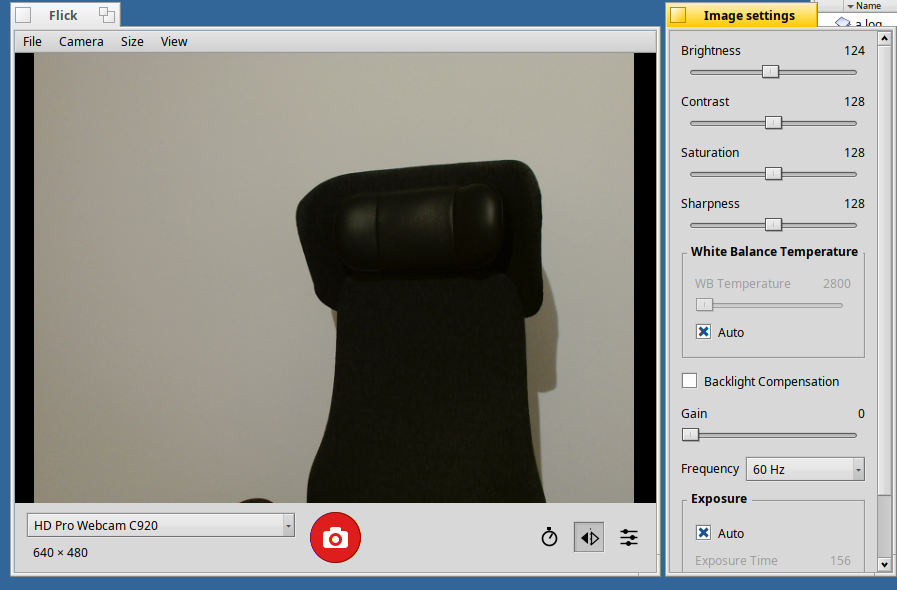

# Flick

A simple webcam app for [RenkuOS](https://github.com/RenkuOS/Source) – pictures with a click.



## What it does

- Shows the live picture of a USB webcam and saves a photo as PNG in
  `~/Pictures` with one click, the space bar or Alt+S.
- Switches between cameras and picture sizes while it runs.
- Self-timer (3 seconds), a short flash when the photo is taken, and a
  mirrored picture like in a mirror.
- Image settings of the camera: brightness, contrast, saturation, sharpness,
  white balance, backlight compensation, gain, power line frequency and
  exposure, as far as the camera offers them.
- Drag the picture to Tracker or another app to save or send it.
- English and German.

## What it needs

Flick is made for RenkuOS. It talks to the camera through the Media Kit and
the `usb_webcam` media add-on, and the cameras need a few fixes in RenkuOS
that are on their way:

- [#534](https://github.com/RenkuOS/Source/pull/534) xhci: isochronous
  transfers
- [#535](https://github.com/RenkuOS/Source/pull/535) usb_raw: transfers
  that outlive their caller
- [#548](https://github.com/RenkuOS/Source/pull/548) USB bus manager:
  ending transfers before an alternate setting changes
- the UVC add-on: formats, sizes and controls

Without them Flick starts, but may show no picture. Tested on a ThinkPad
T470s with its built-in camera (Lite-On 04ca:7066) and a Logitech C920.

At 720p and larger the cameras send uncompressed pictures at only 5 to 10
frames per second over USB 2.0. MJPEG in the UVC add-on, for 30 frames per
second at every size, is the next step.

## Building

On RenkuOS, with `haiku_devel` and `makefile_engine` installed:

```
make
make bindcatalogs
```

The program is in `objects.*/Flick`. `sh packaging/make-hpkg.sh <version>`
packs it into an `.hpkg`. The CI builds it in a Haiku R1/beta5 VM, which has
the same interfaces; it is meant to run on RenkuOS.

The logic tests run on any system with a C++ compiler:

```
make -C tests
```

## Translations

`make catkeys` writes `locales/en.catkeys` from the sources. Copy it to
`locales/<language>.catkeys`, translate the last column, keep the first line
as it is and add the language to `LOCALES` in the `Makefile`.

## License

MIT, see [LICENSE](LICENSE).
